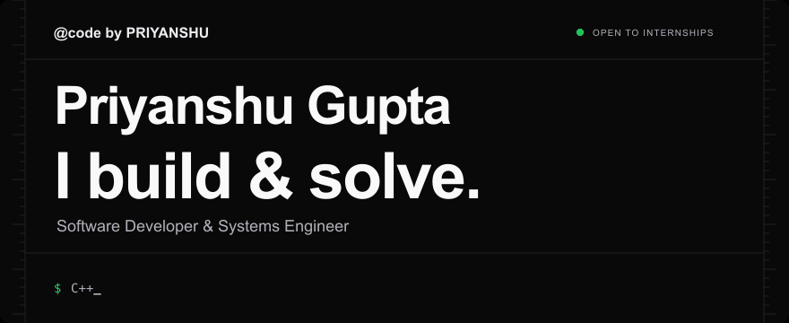
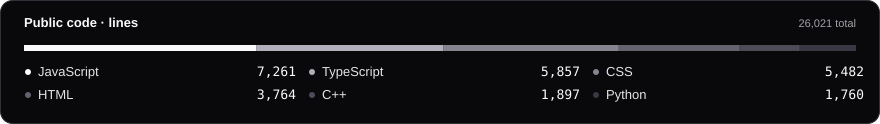

<p align="center">
  <a href="https://priyanshugupta.com/">
    <picture>
      <source media="(prefers-reduced-motion: reduce)" srcset="assets/readme/header-static.png" />
      
    </picture>
  </a>
</p>

I'm **Priyanshu Gupta**, a software developer focused on **C++ & algorithms**, **Linux systems**, and **React / Next.js** development. I like understanding how things work, solving problems, and turning what I learn into working projects. Open to **internships and collaboration**.

<p align="center">
  <a href="https://priyanshugupta.com/"></a>
  <a href="https://www.linkedin.com/in/priyanshubuild/"></a>
  <a href="mailto:priyanshug1408@gmail.com"></a>
  <a href="https://leetcode.com/u/Priyanshuguptaleetcode/"></a>
  <a href="https://github.com/priyanshubuild"></a>
</p>

<p align="center">
  <a href="https://codeforces.com/profile/priyanshuguptacf"></a>
  <a href="https://www.codechef.com/users/priyanshucf"></a>
  <a href="https://x.com/priyanshustwt"></a>
</p>

<p align="center">
  
  
  
  
  
  
  
  
</p>

<!-- activity:start -->
<p align="center">
  <a href="https://github.com/priyanshubuild"></a>
  <a href="https://github.com/priyanshubuild?tab=repositories"></a>
</p>

<sub>Past 365 days · Updated daily · Snapshot: 2026-10-16 UTC.</sub>
<!-- activity:end -->

### What I'm working on

- **Problem solving:** practicing data structures and algorithms in C++, with solutions and learning progress on GitHub and coding platforms.
- **Web development:** building responsive interfaces with React, Next.js, TypeScript, and Tailwind CSS, including this portfolio.
- **Systems fundamentals:** exploring Linux, the command line, operating systems, and how software works beneath the interface.

I value readable code, a strong understanding of the fundamentals, and steady improvement. My portfolio brings together my projects, skills, and ways to get in touch.

<details>
<summary>How these numbers are counted</summary>

Activity covers the past year. Contributions include GitHub's contribution types; authored commits count public commits attributed to me. The language card shows the four largest languages by the size of code stored in my public repositories, excluding forks. It isn't a measure of time spent coding or skill: larger files can outweigh many small solutions. Smaller languages are included in the total, so the four shown may not add up to 100%.

</details>

<details>
<summary><strong>About this repository</strong></summary>

This repository contains my portfolio website and the assets for this profile README. The website uses **Next.js 15, React 19, TypeScript, and Tailwind CSS 4**.

### Run the portfolio locally

```sh
npm install
npm run dev
```

Open [localhost:3000](http://localhost:3000/). Optional server settings and verification details are documented in [the portfolio notes](docs/PORTFOLIO-QUALITY.md).

### README visuals

The banner, animation, link badges, and activity card live in this repository. A [daily workflow](.github/workflows/readme-activity.yml) refreshes the activity snapshot from the same verified public data used by the website. A failed refresh keeps the previous snapshot.

[Asset generation and refresh details](docs/README-ASSETS.md)

</details>
